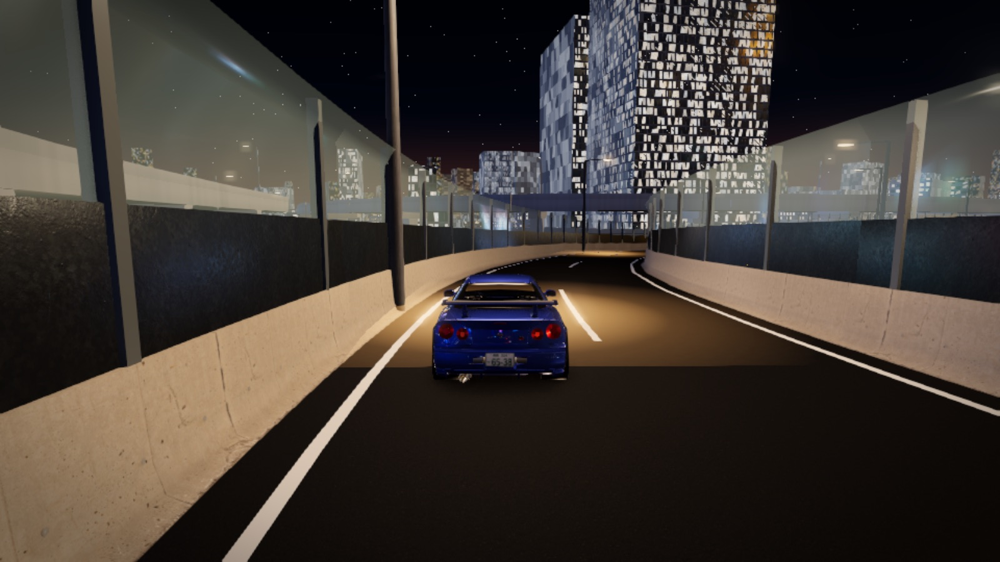

# MIDNIGHT JAPAN — ミッドナイト・ジャパン · 미드나잇 재팬

Free 3D browser driving game — the real Japan in five places, rebuilt from OpenStreetMap and elevation data:
the C1 Inner Circular through central Tokyo, the Hakone Turnpike touge, the K1 Yokohama loop, Daikoku PA and the
Shuto Bayshore Route, and the streets of Yokohama and Tokyo (546,000 buildings, traffic, trains, people, Haneda, rain).

**Play: https://midnight-japan.github.io/** — runs in the browser, no install.

Credits & licences: [credits.html](https://midnight-japan.github.io/credits.html) · Map data © OpenStreetMap contributors (ODbL).
