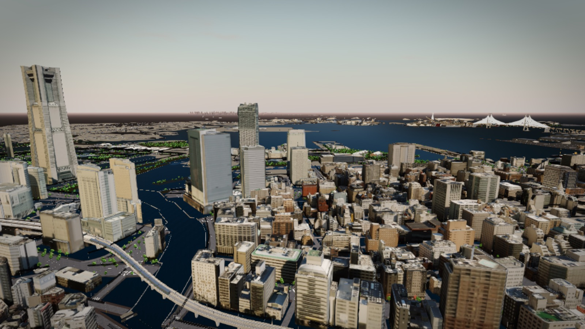

# MIDNIGHT JAPAN — ミッドナイト・ジャパン · 미드나잇 재팬

**Real 3D Japan in your browser.** A free 3D driving game on one connected network of real Japanese roads — Daikoku PA and
the Shuto Bayshore, the K1/K3 Yokohama loop, Route 1 Haneda, the Rainbow Bridge, the C1 Inner Circular and the Hakone
Turnpike — through the real buildings of 46 wards and cities (all 23 Tokyo wards, Yokohama, Kawasaki and more) streamed
from Japan's national 3D city model, Project PLATEAU.

**Play: https://midnight-japan.github.io/** — runs in the browser, no install.

Credits & licences: [credits.html](https://midnight-japan.github.io/credits.html) · Buildings: 3D都市モデル（Project PLATEAU）国土交通省 ·
Map data © OpenStreetMap contributors (ODbL).
