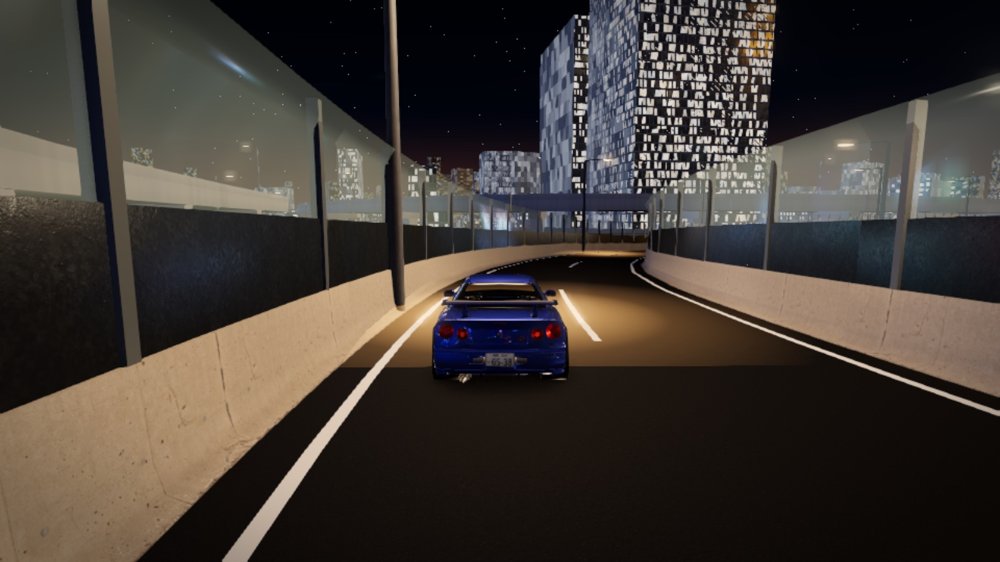

# MIDNIGHT JAPAN — ミッドナイト・ジャパン · 미드나잇 재팬

Free 3D browser driving game — one connected network of real Japanese roads, rebuilt from OpenStreetMap and elevation data:
Daikoku PA and the Shuto Bayshore, the K1/K3 Yokohama loop, Route 1 Haneda, the Rainbow Bridge, the C1 Inner Circular through
central Tokyo, and 59 km of coastal bypasses to the Hakone Turnpike touge — with the cities along the way (790,000 buildings,
traffic, trains, people, Haneda, rain).

**Play: https://midnight-japan.github.io/** — runs in the browser, no install.

Credits & licences: [credits.html](https://midnight-japan.github.io/credits.html) · Map data © OpenStreetMap contributors (ODbL).
